  

# 🚀 Awesome RAG Applications

  
  
  
  
  
  
  

> **A curated directory of production-grade SaaS platforms and open-source applications for Retrieval-Augmented Generation (RAG), Enterprise Workplace Search, Cited Document Intelligence, and Self-Hosted Knowledge Systems.**

---

## 📌 Overview & Scope

This repository tracks ready-to-deploy **complete RAG applications** rather than foundational building-block libraries or basic SDK frameworks (such as raw LangChain or LlamaIndex). 

A qualified **RAG Application** connects directly to enterprise and unstructured data sources, parses complex layouts and tables, builds unified semantic and hybrid vector indices, enforces granular document permissions, and generates answers backed by **verifiable citations and source attribution**.

Whether you are evaluating turnkey enterprise SaaS search across fragmented workplace tools or deploying self-hosted, air-gapped open-source platforms for data sovereignty, this directory provides technical specifications, pricing baselines, and deployment architectures.

---

## 📑 Table of Contents

- [📊 Sector Overview & Market Dynamics](#-sector-overview--market-dynamics)
- [🏢 SaaS & Hosted Platforms](#-saas--hosted-platforms)
- [💻 Open-Source RAG Applications](#-open-source-rag-applications)
- [📈 Star History](#-star-history)
- [💖 Support & Community](#-support--community)
- [🤝 How to Contribute](#-how-to-contribute)
- [⚖️ Disclaimer](#-disclaimer)

---

## 📊 Sector Overview & Market Dynamics

The enterprise search and Retrieval-Augmented Generation (RAG) sector represents an estimated **$7.8B to $8.5B addressable market in 2026**, projected to surge past **$20B+ combined by 2030** as enterprise workloads transition from keyword search to neural generative discovery. Dedicated enterprise RAG software is expanding at a hyper-growth compound annual rate of **~38% to 49% CAGR**, fueled by enterprise urgency to eliminate LLM hallucinations and securely ground generative models in proprietary corporate knowledge.

Rather than consolidating into a winner-take-all monopoly, the sector remains **moderately to highly fragmented at the application layer**. While hyperscalers (AWS, Microsoft Azure, Google Cloud) dominate underlying cloud compute and foundation model distribution, enterprise knowledge retrieval requires deep connector ecosystems, complex document-level access control inheritance (ACLs), multi-modal layout parsing (OCR, tables, charts), and air-gapped data sovereignty. Consequently, market share is distributed across specialized platforms: vertical leaders in financial and legal research (AlphaSense, Hebbia, OpenGP), developer search engines (Algolia, Meilisearch), general enterprise workplace aggregators (Glean), and sovereign self-hosted open-source platforms (Dify, RAGFlow, AnythingLLM, Onyx).

---

## 🏢 SaaS & Hosted Platforms

The following hosted solutions provide turnkey managed infrastructure, pre-built enterprise connectors (Slack, Google Drive, Jira, Salesforce, SharePoint), managed embedding and vector pipelines, and out-of-the-box user interfaces. 

*Platforms are sorted in descending order by company valuation and enterprise size.*

| 🏢 Platform | 💰 Company Valuation / Revenue | 🏷️ Starting Pricing | 🎁 Free Tier / Trial Limits | 🎯 Key Strengths & Target Use Case |
| :--- | :--- | :--- | :--- | :--- |
| **[Amazon Kendra](https://aws.amazon.com/kendra/)** | **~$2.1 Trillion** *(Amazon / AWS)* | **$230 / month** *(GenAI Enterprise Edition base index at $0.32/hr; Developer Edition at $810/mo)* | **30-Day Free Trial** *(Up to 750 free hours of Developer or GenAI Enterprise Edition, 10,000 documents, and 4,000 queries/day)* | AWS-native enterprise search with natural language indexing, pre-built AWS identity integration, and direct S3/SharePoint connectors. |
| **[Elastic Enterprise Search](https://www.elastic.co/enterprise-search)** | **~$9.2 Billion** *(Elastic N.V. - NYSE: ESTC)* | **$95 / month** *(Standard Cloud Hosted tier; Serverless search models available)* | **14-Day Free Trial** *(Full cluster access with 8 GB RAM and 240 GB storage across AWS, GCP, or Azure)* | Distributed hybrid vector + BM25 search engine with web crawlers, workplace connectors, and native Lucene infrastructure. |
| **[Glean](https://www.glean.com/)** | **~$7.2 Billion** *(Series E Valuation)* | **$4,500 / month** *($45/user/month with standard 100-seat minimum; ~$54,000/year contract)* | **30-Day Sandbox PoC** *(Sales-guided enterprise proof-of-concept for up to 50 users and 3 enterprise connectors)* | Benchmark workplace AI search platform connecting 100+ SaaS apps with native permission-aware retrieval and personalized employee discovery. |
| **[AlphaSense](https://www.alpha-sense.com/)** | **~$4.0 Billion** *(Valuation; ~$200M+ ARR)* | **$833 / month** *($10,000/seat/year billed annually for core analyst license)* | **14-Day Evaluation Trial** *(Customized trial with full access to public SEC filings, global news, and earnings call transcripts upon sales qualification)* | AI-powered market intelligence and document analysis platform purpose-built for financial analysts, investment firms, and corporate strategy teams. |
| **[Algolia](https://www.algolia.com/)** | **~$2.25 Billion** *(Valuation; ~$100M+ ARR)* | **$0 / month base** *(Grow tier: $0.50 per 1k searches & $0.40 per 1k records over free limits; Elevate tier starts at $500/mo)* | **Free Forever Plan** *(10,000 search requests/month, 100,000 records, 5,000 recommendations, and 1 GB index capacity)* | Ultra-low latency hosted search APIs with typo tolerance, instant faceting, and hybrid semantic search for websites and e-commerce catalogs. |
| **[Coveo](https://www.coveo.com/)** | **~$1.0 Billion** *(TSE: CVO; ~$135M ARR)* | **$990 / month** *(Base marketplace package; mid-market deployments average $2,890/mo or $34,700/year)* | **14-Day Free Trial** *(Full enterprise prototype organization with pre-built connectors and relevance tuning; expires after 14 days)* | Unified enterprise relevance and AI search engine designed for enterprise customer service, Salesforce Service Cloud, and ServiceNow portals. |
| **[Hebbia](https://www.hebbia.com/)** | **~$700 Million** *(a16z-led Series B)* | **$2,083 / month** *($3,000/seat/year with ~$25,000/year minimum workspace commitment)* | **14-Day Guided Pilot** *(Sales-provisioned evaluation workspace supporting up to 500 document uploads and matrix queries)* | AI document review and matrix analysis platform for private equity, investment banking, and legal due diligence with exact citation tracing. |
| **[Lucidworks Fusion](https://lucidworks.com/)** | **~$370 Million** *(Valuation; ~$47M ARR)* | **$2,333 / month** *(Starting annual contracts average ~$28,000/year for Lucidworks Cloud)* | **14-Day Sandbox PoC** *(Sales-approved evaluation sandbox with up to 50,000 documents across standard web and file store connectors)* | Scalable enterprise search built on Apache Solr with visual query pipeline designers, machine-learned relevance, and hybrid reranking. |
| **[Sinequa](https://www.sinequa.com/)** | **~$200 Million** *(Part of $1B+ ChapsVision; ~$35M ARR)* | **$3,333 / month** *(Base annual enterprise licenses start around ~$40,000/year scaled by indexed document volume)* | **30-Day Scoped PoC** *(Enterprise evaluation pilot for up to 100,000 documents across 2 native connectors)* | High-compliance enterprise search and RAG platform with 200+ legacy connectors, specialized for aerospace, pharma, and defense industries. |

---

## 💻 Open-Source RAG Applications

Open-source RAG applications provide complete control over data sovereignty, private network deployment, zero per-seat licensing fees, and flexible LLM/embedding choices (Ollama, vLLM, HuggingFace, OpenAI, Anthropic). 

*Projects are sorted in descending order by GitHub Stars_Count.*

### 1. [Dify](https://github.com/langgenius/dify) 
* **Description:** An all-in-one open-source LLM application development platform that combines visual prompt orchestration, agent workflows, and an enterprise-grade RAG pipeline.
* **Key Technical Capabilities:** Multi-source document ingestion (PDF, DOCX, Markdown, Notion, Web), automated visual chunking preview, dense + sparse hybrid vector search (Qdrant, Milvus, Weaviate, pgvector), re-ranking models, and customizable citation-grounded web apps and APIs.
* **License:** Apache-2.0
* **Best For:** Engineering teams needing a production-ready visual workflow builder and RAG pipeline supporting both cloud and self-hosted models.

### 2. [RAGFlow](https://github.com/infiniflow/ragflow) 
* **Description:** A leading open-source RAG engine built on deep document understanding that bridges OCR, complex table parsing, and grounded citations.
* **Key Technical Capabilities:** YOLOv8-based layout detection (DeepDoc) that preserves row/column coordinate mappings for tables and complex figures; template-based chunking (Law, Manual, Book, Paper, Resume); hybrid retrieval (BM25 + dense vector RRF); and pixel-exact bounding-box citations in PDF previewers.
* **License:** Apache-2.0
* **Best For:** Legal, medical, financial, and technical document Q&A where extracting structured data and tables with pixel-exact citations is mandatory.

### 3. [AnythingLLM](https://github.com/Mintplex-Labs/anything-llm) 
* **Description:** A full-stack, zero-setup desktop and server-deployable RAG application with complete multi-user support, workspace isolation, and native vector storage.
* **Key Technical Capabilities:** Bundled local embedding and LLM runners (Ollama, LM Studio, LocalAI) alongside commercial APIs; workspace-level document segregation; multi-modal document scrapers; agent skills; and built-in LanceDB vector storage requiring no external database setup.
* **License:** MIT
* **Best For:** Small-to-medium teams and developers seeking an out-of-the-box local or self-hosted RAG application with an intuitive desktop or web UI.

### 4. [Meilisearch](https://github.com/meilisearch/meilisearch) 
* **Description:** A lightning-fast, open-source search engine providing sub-50ms hybrid semantic search, typo-tolerant search-as-you-type, and native vector embeddings.
* **Key Technical Capabilities:** Built-in vector search integration with OpenAI, Hugging Face, and Ollama; automated tokenization; customizable ranking rules; and native RESTful APIs with multi-language SDKs.
* **License:** MIT
* **Best For:** Applications requiring instant full-text search combined with semantic vector retrieval for responsive user-facing search bars.

### 5. [Quivr](https://github.com/The-Vibe-Company/quivr) 
* **Description:** An open-source personal AI assistant and "Second Brain" RAG application designed to organize, search, and synthesize information across personal and team knowledge repositories.
* **Key Technical Capabilities:** Modular brain architecture allowing isolated knowledge bases; multi-format document ingestion (PDF, CSV, TXT, Markdown, audio, video); Supabase pgvector integration; and multi-model routing.
* **License:** Apache-2.0
* **Best For:** Individual knowledge workers and teams wanting a conversational personal assistant across unstructured notes, documents, and multimedia.

### 6. [Langchain-Chatchat](https://github.com/chatchat-space/Langchain-Chatchat) 
* **Description:** A widely adopted open-source local knowledge base Q&A application powered by LangChain and local LLMs (ChatGLM, Qwen, Llama).
* **Key Technical Capabilities:** Complete offline deployment; hybrid vector storage (Milvus, FAISS, pgvector); document parsing with OCR support; and enterprise knowledge base management interface.
* **License:** Apache-2.0
* **Best For:** Enterprise deployments in privacy-sensitive or air-gapped environments requiring Chinese and multi-language support on local GPU infrastructure.

### 7. [Khoj](https://github.com/khoj-ai/khoj) 
* **Description:** An open-source, personal AI second brain and local knowledge assistant that operates across desktop, web, Obsidian, and Emacs.
* **Key Technical Capabilities:** Continuous background indexing of local markdown notes, PDFs, GitHub repositories, and Notion; offline-first local model execution; voice interaction; and scheduled AI research agents.
* **License:** AGPL-3.0
* **Best For:** Developers, researchers, and note-takers desiring deep integration with Obsidian, Emacs, or desktop markdown vaults.

### 8. [Onyx](https://github.com/onyx-dot-app/onyx) 
* **Description:** The leading open-source alternative to Glean — a self-hosted enterprise search and conversational AI assistant platform.
* **Key Technical Capabilities:** 40+ native enterprise connectors (Slack, Google Drive, Confluence, Jira, GitHub, Salesforce, Notion); document-level Access Control List (ACL) permission inheritance; hybrid vector + keyword search; and fully private VPC deployment.
* **License:** MIT
* **Best For:** Companies needing a self-hosted Glean alternative with strict document access permission preservation and comprehensive workplace SaaS connectors.

### 9. [FastGPT](https://github.com/labring/FastGPT) 
* **Description:** A high-performance knowledge-based Q&A system built on LLMs, providing end-to-end data processing, visual workflow orchestration, and multi-channel publishing.
* **Key Technical Capabilities:** Visual node-based RAG workflow editor; automated document QA pair generation; hybrid vector search (PostgreSQL/pgvector); multi-tenant permission controls; and easy deployment into WeChat, Feishu, and web widgets.
* **License:** Apache-2.0
* **Best For:** Customer service automation, internal company bots, and knowledge base applications requiring visual query flow design.

### 10. [Typesense](https://github.com/typesense/typesense) 
* **Description:** An open-source, in-memory search engine providing typo-tolerant keyword search, vector search, and hybrid semantic search in a single binary.
* **Key Technical Capabilities:** Integrated auto-embedding generation via OpenAI, Vertex AI, or local models; sub-10ms response times; Raft-based high-availability clustering; and seamless Algolia-compatible API design.
* **License:** GPL-3.0
* **Best For:** High-throughput developer search, catalog search, and lightweight vector retrieval without complex infrastructure dependencies.

### 11. [Kotaemon](https://github.com/Cinnamon/kotaemon) 
* **Description:** A local-first, modular RAG web UI featuring visual citations and multi-vector parent-child document indexing.
* **Key Technical Capabilities:** Small-chunk semantic indexing linked to larger parent sections for generation context; visual PDF viewer with highlighted bounding-box citations; note-taking interface; and GraphRAG knowledge graph exploration.
* **License:** Apache-2.0
* **Best For:** Researchers, analysts, and academic users who require interactive, verifiable visual citations in complex academic and technical PDFs.

### 12. [QAnything](https://github.com/netease-youdao/QAnything) 
* **Description:** NetEase Youdao's open-source local knowledge base question-answering system designed for arbitrary document formats and large multi-tenant repositories.
* **Key Technical Capabilities:** Two-stage retrieval pipeline (embedding vector retrieval + cross-encoder re-ranking); robust OCR and multi-format document parsing; and tailored two-stage rerank models delivering high retrieval precision on messy business documents.
* **License:** Apache-2.0
* **Best For:** High-precision document question-answering on diverse formats (PDF, Word, PPT, Excel, Images) with local GPU acceleration.

### 13. [Verba](https://github.com/weaviate/Verba) 
* **Description:** Weaviate's "Golden RAGtriever" — an aesthetic, pre-configured open-source RAG web application built for rapid setup and intuitive document exploration.
* **Key Technical Capabilities:** Pre-configured best practices for chunking, embedding, and vector search on Weaviate; broad model support (OpenAI, Anthropic, Cohere, Groq, Ollama, HuggingFace); and multi-format data ingestion with Unstructured.io.
* **License:** BSD-3-Clause
* **Best For:** Developers wanting an immediate, functional RAG application with sensible defaults and zero pipeline configuration overhead.

### 14. [OpenBeam](https://github.com/kuluruvineeth/openbeam) 
* **Description:** An open-source workplace search platform bridging digital SaaS applications with physical operations and industrial IoT telematics.
* **Key Technical Capabilities:** 87+ connectors across digital workplace platforms (Slack, Notion, Linear, GitHub) and physical operations systems (Samsara, AWS IoT, MQTT, OPC-UA); sub-200ms hybrid search; and MCP (Model Context Protocol) server support for AI code editors.
* **License:** AGPL-3.0
* **Best For:** Logistics, manufacturing, and operational enterprises needing unified search across both digital software stacks and physical field equipment.

### 15. [OpenGP](https://github.com/vivan1211/opengp) 
* **Description:** A self-hosted, cited AI intelligence platform tailored specifically for private equity and investment portfolio management.
* **Key Technical Capabilities:** Automated virtual data room parsing (OCR + financial tables); pgvector hybrid retrieval; cited passage linking; isolated Python sandbox code interpreter for financial modeling; and multi-tenant Postgres row-level security.
* **License:** AGPL-3.0
* **Best For:** Private equity, venture capital, and hedge funds requiring air-gapped financial document analysis and verifiable data room chat.

---

## 📈 Star History

---

## 💖 Support & Community

Thank you for exploring this curated directory of RAG applications! If you find this repository valuable for your research, production architecture, or open-source discovery:

* ⭐ **Star this repository** to help fellow developers and AI teams discover it.
* 🍴 **Fork the repository** and submit PRs to keep listings accurate and current.
* 📢 **Share with colleagues** in your engineering, ML, and search communities.
* ☕ **Sponsor & Buy a Coffee:** Support continuous maintenance and research via the [GitHub Sponsor Dashboard](https://github.com/sponsors/ishandutta2007).

---

## 🤝 How to Contribute

Contributions are welcome and highly appreciated! To submit a new SaaS platform or open-source RAG application:

1. **Fork the repository** on GitHub.
2. **Add or update your entry** in `README.md` following the established table or card format.
3. **Verify criteria:** Entries must be complete *applications* (not raw libraries), with verifiable documentation, active maintenance, and accurate pricing or licensing info.
4. **Submit a Pull Request** with a concise explanation of the application's unique strengths and architecture.

---

## ⚖️ Disclaimer

* This repository is an independent, community-curated directory intended for technical education and evaluation.
* Product names, logos, valuations, and trademarks are the property of their respective owners.
* Pricing figures, free tier limits, and valuations reflect public market disclosures, procurement estimates, and vendor updates as of 2026. Because SaaS pricing changes periodically, please consult official vendor documentation prior to procurement.
* Self-hosting open-source RAG applications removes software licensing fees but requires infrastructure management, vector database operations, connector token refresh handling, and identity-aware access control governance.

---

  Built with ❤️ for AI engineers, enterprise search teams, and knowledge architects worldwide.

